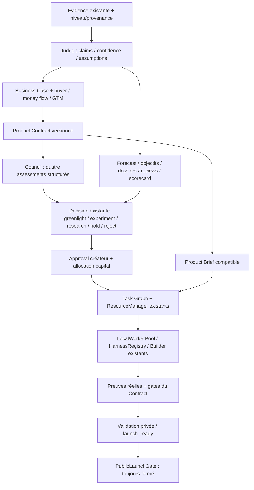

# Lot R — Company Operating System

## Résultat et portée

La fondation compagnie est persistante, versionnée et intégrée aux infrastructures
Product Factory existantes. Elle fournit des décisions structurées, une hiérarchie
de preuves, des contrats, des gates, des objectifs, des modèles économiques,
des allocations et des revues. Elle ne crée aucun exécuteur commercial.

La simulation valide la logique de gouvernance, les transitions, la séparation
financière et la persistance. **Elle ne prouve pas que la compagnie gagnera de
l'argent.** Les sources économiques des tests sont des doubles déterministes de
contrats de providers, y compris lorsqu'elles simulent un provider « observed ».
Aucun achat, paiement client, rétention réelle ou campagne réelle n'a eu lieu.

La limite du lot 4C reste intacte : modèles de test déterministes, compilation et
parcours HTTP réellement exécutés dans Docker, aucune généralisation avec LLM
externe ni parcours navigateur réel démontré. L'intégration Company→Builder
ajoute un vrai parcours technique avec un double de modèle, pas une validation
économique ou une nouvelle preuve de généralisation.

## Audit R0 et architecture retenue

Voir [la carte d'intégration R0](product-factory-lot-r-integration-map.md).
Evidence et Decision étaient extensibles ; Brief/Build avaient déjà des records
versionnés dans KV ; les réservations, approvals et gates étaient déjà présentes.
Ces mécanismes ont été réutilisés plutôt que remplacés.



`CompanyOperatingSystem` est une façade de services métier synchrones. Elle n'a
ni tick autonome, timer, appel LLM, worker, heartbeat ni accès réseau. Les tâches
de recherche qu'elle propose utilisent `FactoryOrchestrator.planAction()` et les
réservations du Resource Manager. Les expériences réutilisent hypotheses et
experiments ; la voix du client et l'apprentissage réutilisent feedback/learnings.
Le heartbeat existant demeure la seule infrastructure de cadence éventuelle.
Les cadences de revue sont une configuration, sans démarrage automatique.

## Compagnie et droits de décision — R1/R24/R32

Le Company Model conserve mission, objectif de profit durable ajusté au risque et
valeur client, créateur, configuration, quatre fonctions, capacités spécialisées,
hiérarchie de droits et boucle MAKE/GROW/PROTECT/REINVEST.

Les quatre fonctions sont des responsabilités structurées, pas quatre agents
permanents en débat. Entrepreneur possède les décisions business/portfolio ;
Builder produit contrats techniques/qualité/santé et peut bloquer les gates ;
Growth fournit GTM et assessments de distribution ; Judge gère preuves, métriques,
contradictions et calibration. CFO, Customer Success, Market Intelligence,
Pricing, Security/Privacy, Legal, Incident et B2B Sales sont des capacités appelables.

Les APIs contrôlent les fonctions autorisées. Seul `CREATOR` peut imposer/modifier
un objectif futur ou reconfigurer la compagnie. Les Decisions conservent fonction,
owner, inputs, versions, assumptions, alternatives, contradictions, expected
outcome, reversibility, approval et résultat policy. Le service de planning utilise
un adaptateur du PolicyEngine existant ; admission manquante → HOLD. Une policy
refusée ne peut pas activer capital, greenlight, transition portfolio ou exécution.

L'API est une frontière **interne de confiance** : l'identité du créateur et le
rôle doivent venir du runtime autorisé, jamais du texte externe ou d'une sortie
modèle. Aucun nouvel outil exposant ces APIs aux modèles n'est enregistré dans R.
Les futures interfaces humaines/outils devront conserver cette frontière.

## Evidence, Confidence Ledger et assumptions — R2/R16E

`Evidence.company` ajoute niveau 0–5, origine model/synthetic/public/observed,
aspect, validité, référence de vérification, mesures et scope/monnaie/période
économiques. Les anciens records restent compatibles et non promus : absence
explicitement connue de classification, aucune déduction de paiement réel.

Les providers de gouvernance sont configurés avec une origine fixe. Public ou
observed exigent un callback de vérification de confiance ; pas de fallback.
Model = niveau 0 ; synthetic = 1 ; public = 2 ; observed = 3–5. La classification
et les sources annotées deviennent immuables au niveau SQL. Les doublons ne
peuvent pas changer de niveau. Les contenus restent des données non fiables.

Les claims relient preuves et assumptions. La confiance est un **heuristique**
explicable : sources indépendantes au niveau frais dominant, support/refutation,
pénalité de stale/change. Des sources synthétiques ne noient pas une observation
réelle défavorable. Les contradictions restent visibles. Changement de version
assumption, expiration ou refutation diminuent/stalent le résultat ; les calculs
identiques réutilisent l'évaluation existante sans nouvel audit inutile.

Le Critical Assumption Register conserve statut, range, provenance, expiration,
produits affectés et versions. `assumptionImpact()` matérialise produits/decisions
affectés et demande de review. Les décisions snapshotent les versions utilisées.
Les gardes du Brief et de l'allocation refusent les assumptions invalides/stales.
Les décisions historiques ne sont pas réécrites avec les nouvelles connaissances.

## Market Intelligence, Business Case et Contract — R3–R5A

Les représentations comprennent competitor observations, 11 classifications de
reviews, buyer/user/champion/decision-maker/budget-owner, money-flow evidence,
purchase triggers, switchability, replacement thesis, competitive response et
hypothèses de defensibility. Ranges, confiance, provenance et fraîcheur sont
conservés ; aucune formule universelle de « switchabilité scientifique ».

La bibliothèque de patterns conserve principes, références/hashes/licences,
expiration et `copyingPermitted:false`. Aucun copier de code/assets/branding ou
texte propriétaire n'est ajouté ; les références 4B gardent leur allowlist licence.

Le Business Case contient problème coûteux, workaround, coûts/risques, buyer,
why-now/switch/this, distribution, CAC hypothétique, retention, coût de service,
accessible customers×penetration×revenue-per-customer, ranges et assumptions.
Il représente concentration du revenu, wedge, niches « unfair » hypothétiques,
expansion à valeur supplémentaire, invalidators, desirability et pre-mortem.
Treize modèles business/pricing sont acceptés, dont license, one-time, usage,
commission, hybride, none-yet et do-not-build. Une subscription exige une thèse
de valeur récurrente ; elle n'est pas une préférence imposée.

Le Product Contract est versionné, append-only, lié à un Business Case précis,
GTM, buyer, outcome, evidence, journey, capabilities, exclusions, contraintes,
risques, métriques et gates. Chaque révision conserve pourquoi et quelle fonction
l'a autorisée. Son contexte est transmis dans le JSON utilisateur du Brief/Builder,
pas injecté comme nouvelle instruction système. Les refs key/revision/hash et
Decision de greenlight sont conservées dans le Brief utilisé par le build.

Le Council reçoit exactement quatre assessments concis. Pas de débat LLM. Il
refuse de jeter des contradictions, considère distribution, evidence économique,
buyer, coûts/pricing, fatal risks, assumptions et reversibility. Outcomes :
GREENLIGHT/EXPERIMENT/RESEARCH_MORE/REJECT/HOLD. Les reviews irréversibles exigent
plus de preuves. Le cheapest information experiment est conservé dans les inputs.
Un greenlight ne remplace pas les approvals humaines ni les policies.

Les nouveaux Briefs créés après activation du Company OS doivent avoir un
Contract/greenlight ; les Briefs historiques restent compatibles. Un Contract
modifié invalide le binding d'exécution courant jusqu'à re-review. La création
indépendante d'un deuxième build complet sur le même produit demeure soumise
aux contraintes de révision/replan du Builder existant ; R ne le redesign pas.

## Qualité, santé, GTM et client — R6–R8

Quatorze catégories de gate sont représentées avec PASS/FAIL/BLOCKED/
NOT_APPLICABLE/INSUFFICIENT_EVIDENCE. Le Contract fixe exigence, critère, niveau
et besoin navigateur avant les résultats. Une gate obligatoire ne peut devenir
NOT_APPLICABLE pour cacher un échec. Une affirmation du modèle ne suffit pas :
preuve observée appropriée ou receipt d'acceptance réelle, liée au bon build/probe
et au hash du probe approuvé. Le promote vers launch_ready et les transitions
portfolio vérifient ces gates et la santé.

Le test Company→Builder montre un build réel et un parcours HTTP privé ; la gate
UX échoue d'abord, puis passe avec la preuve structurée de l'erreur de l'API sous
le contrat de ce service. **Cela ne valide pas une UI ni une qualité visuelle.**
Les gates nécessitant un browser ne passent pas avec un double ou une assertion.
Le runtime navigateur isolé demeure indisponible dans l'image actuelle.

Product Health conserve facteurs, incidents et error-budget ; revenue ne peut
remplacer severe bugs, security/reliability/UX critiques. Le statut est dérivé des
facteurs, sans transformer les recettes positives en santé positive.

GTM conserve ICP, buyer, première distribution plausible, channels, message,
offer, creative hypothesis, funnel spécifique au modèle, conversion/CAC, budget,
measurement et stop conditions. Les cinq stages d'acquisition sont représentés.
Aucune interdiction temporelle arbitraire et aucune campagne exécutée. Les plans
et rollbacks commerciaux ont `execution:disabled`.

VoC comprend onboarding, activation, support, demandes, satisfaction, cancellations,
expansion, win/loss et non-buyers avec provenance. Churn peut être saisonnier,
payment failure, UX, prix, concurrence, support, fermeture client ou unknown ;
il n'est pas automatiquement attribué à une mauvaise qualité. Les helpers
réutilisent feedback et learnings et sont idempotents.

## Économie, capital et runway — R9–R9J

Les snapshots distinguent gross revenue, refunds, net revenue, fees, acquisition,
model/API, hosting, variable/support/operating costs, contribution, profit, cash
et committed capital. Monnaie et cents entiers sont explicites. Les buckets
attributables sont déclarés disjoints, sinon pas de calcul crédible.

Net = gross − refunds ; contribution = net − coûts attribuables disjoints ;
profit = contribution − operating cost. **Un coût requis UNKNOWN rend le résultat
UNKNOWN**, pas zéro. Cash ne se déduit pas du profit. Les valeurs calculées ne
peuvent pas être remplacées par un profit affirmé. Les unit metrics ne peuvent
pas écraser les métriques économiques canoniques.

Les facts monétaires doivent correspondre aux mesures vérifiées, scope produit/
portfolio, monnaie et période fixes. Gross/refunds réclament paiement settled et
niveau ≥4 ; trial/pending/synthetic ne donnent pas une actual réelle. Les coûts
négatifs artificiels, doublons de référence et déplacement entre périodes sont
refusés. Les ratios/unit economics, revenu de qualité et scorecards préservent
nature, provenance/confidence et UNKNOWN. Les données calculées de futurs
connecteurs devront fournir des mesures/calculs vérifiables à cette frontière.

Capital proposals conservent cash, Builder hours, compute, expected profit,
probability ranges, downside/upside, payback, reversibility, assumptions, risques,
alternatives et marginal contribution. Comparaison déterministe explicable avec
return-on-capital et return-on-Builder-hour ; historical sunk cost ne crée aucun
mérite. Les facteurs/ranges restent consultables dans la proposition d'origine.
La comparaison est une politique conservatrice, pas une prévision objective.

Capital staging et value-of-information sont représentés. Les allocations
proposées/committed comptent contre les plafonds, demandent une approval exacte
hashée et ne doublent pas au restart. Les coûts déjà consommés réduisent le
capital restant. Ressource/slot/lease reste l'autorité du Resource Manager ; les
caps compagnie complètent ces contrôles, y compris dans la boucle modèle.
Aucune allocation inter-produit, libération avec leases actives ou recharge
silencieuse depuis les recettes créateur.

Runway/burn/obligations/safety margin sont représentables ; le calcul renvoie
UNKNOWN si les inputs manquent ou burn est indéfini. R n'est pas un ledger
comptable bancaire, ne récupère aucun revenu réel et n'effectue aucun transfert.

## Owner Targets, gap, forecasts et reviews — R10–R13E

Les Owner Targets sont des données du créateur, versionnées et figées dès le
commencement du period. Les changements futurs exigent `CREATOR` et un motif.
Les records historiques et définitions de métriques référencées restent lisibles.
Pas de cible rétroactive pour fabriquer une réussite. Un Internal Stretch Target
est séparé, strictement supérieur, soumis à policy et preuves de répétabilité/
retention ; il ne remplace pas l'objectif du créateur.

La configuration initiale spécifique au créateur est dans
[company-owner-targets.initial.json](examples/company-owner-targets.initial.json),
**disabled et caps zéro par défaut**, sans constantes universelles dans la logique :

| Semaine, Europe/Paris | Objectif de recettes |
|---|---:|
| 12–18 octobre 2026 | 300 € |
| 19–25 octobre 2026 | 700 € |
| 26 octobre–1 novembre 2026 | 1 100 € |
| 2–8 novembre 2026 | 1 500 € |
| 9–15 novembre 2026 | 2 000 € |
| 16–22 novembre 2026 | 2 500 € |

Les intervalles sont début inclus / fin exclusive, avec offsets Europe/Paris.
La semaine du changement d'heure dure 169 heures ; aucun revenu n'est déplacé.
Après la sixième semaine, aucun plafond ou objectif perpétuel n'est inventé.

Revenue Gap = cible − range de forecast crédible. Forecast absent/stale → gap
UNKNOWN. Le gap ne crée aucune application automatiquement. Les comparaisons
peuvent préférer une amélioration, une recherche ou ne pas dépenser.

Forecasts 4/8/12 semaines gardent assumptions, ranges, freshness, confiance,
risques, capital/Builder/acquisition requirements et driver model SaaS/B2B/usage/
transaction/custom. Target, stretch, forecast et actual restent distincts.
Forecast-vs-actual snapshoté : range couvert, error et direction. Une répétition
d'optimisme/pessimisme hors range diminue la confiance du même processus.
Un range honnêtement large couvrant l'actual n'est pas pénalisé.

Les reviews hebdomadaires et mensuelles figent un dossier Judge commun et hashé.
Les quatre assessments sont concis ; contradictions et alternatives restent
persistées. UNKNOWN reste UNKNOWN ; SYNTHETIC ne peut établir attainment réel.
Une miss matérielle reste MISSED et active Recovery si policy l'autorise :
diagnostic causal, stop-doing, priorités et seuil configurable de misses
consécutives vers Strategic Review. Aucun panic spend, release ou manipulation.

Un dépassement demande cause/repeatability/marginal return/saturation/health :
pas d'arrêt automatique et pas de nouveau plafond artificiel. La Monthly Board
Review conserve la question « repartirions-nous avec le même portfolio aujourd'hui ? ».
Daily Pulse ne contient que anomalies matérielles et incidents ; pas de réunion
quotidienne à quatre fonctions. Crisis peut donner priorité à PROTECT.

## Portfolio, learning, risques et anti-gaming — R14–R23B

`PortfolioManager.get()` expose l'overlay économique EXPLORE/VALIDATE/GROW/SCALE/
HARVEST/HOLD/PIVOT/KILL/ARCHIVE sans remplacer les anciens états. Les overlays
ont capital intensity, monitoring, cadence et relations. KILL/ARCHIVE réutilisent
la transition explicite existante et sa cancellation ; aucun automate de kill.
HARVEST exige une profitabilité observée et une santé positive ; croissance faible
ne signifie pas automatiquement fin du produit.

Shadow Portfolio, feature/add-on/plan/premium/bundle/complementary/independent/
replacement alternatives et cannibalization/synergy sont persistés avec preuves.
`portfolioAlternatives()` compare les propositions actives et disponibles sans
sunk-cost bonus, pour le prochain euro/Builder hour/compute. Aucun quota explore/
exploit imposé. Le marginal remplace l'historical average si disponible ;
diminishing returns peuvent rendre SCALE inéligible.

Decision Memory conserve raisonnement original, expected et actual/hindsight
séparés. Causal learning conserve intervention/population/effect/confounders/
method/confiance ; observation temporelle seule ne certifie pas causalité.
Graveyard conserve rejet et conditions de réévaluation. Benchmarks, capability et
growth learning ont métriques/provenance/nature ; une croyance d'agent seule ne
suffit pas à établir une capability réelle.

Quinze types de risques, dependencies, external changes, privacy/minimization/
access/retention/deletion/logging/secrets/isolation, backup/recovery expectations
et traceability change→technical/product/business sont représentés. Pas de SRE,
privacy engine, monitoring continu ou hosting ajouté. Les rollbacks business
prix/packaging/offer/funnel/campaign/feature/deployment sont des intentions
versionnées, sans exécution commerciale.

Anti-gaming : SQL append-only ; objectifs/definitions historiques figés ; source
annotée immuable ; calculs profit/refunds/costs explicites ; actuals vérifiées ;
synthetic/trial exclus ; ownership immuable ; aucune fusion budget/recettes ;
qualité/sécurité/approval non outrepassées par la pression cible. ACTIVITY/
PROGRESS/RESULT sont explicites dans les Metric Definitions. Company Scorecard
expose métriques, targets, forecasts, gap, Product Health et facteurs de portfolio,
avec UNKNOWN à la place des données indisponibles, sans score opaque obligatoire.

## Fichiers du Lot R

Les fichiers suivants sont ajoutés par Lot R, indépendamment du fait que les
dossiers Product Factory des lots précédents sont encore non suivis par Git.

| Fichiers ajoutés | Rôle |
| --- | --- |
| `src/product-factory/company-types.ts` | Domaine compagnie, records, nature des mesures et droits |
| `src/product-factory/company-config.ts` | Configuration conservatrice et validation |
| `src/product-factory/company-store.ts` | Versions append-only dans SQLite existant |
| `src/product-factory/company-economics.ts` | Comptabilité, ranges, capital, gap, calibration |
| `src/product-factory/company-evidence.ts` | Providers, niveaux, confiance et contradictions |
| `src/product-factory/company-governance.ts` | Council, autorisations métier et quality gates |
| `src/product-factory/company-policy.ts` | Admission via PolicyEngine existant |
| `src/product-factory/company-guards.ts` | Guards Brief/Builder/ResourceManager/qualité/capital |
| `src/product-factory/company-os.ts` | Façade persistante des workflows compagnie |
| `src/__tests__/product-factory/company-adversarial.test.ts` | Scénarios A–X et protection santé/crise |
| `src/__tests__/product-factory/company-persistence.test.ts` | Migration, versioning, reload, invariants |
| `src/__tests__/product-factory/company-e2e.test.ts` | Simulation compagnie, expériences, feedback et reviews |
| `src/__tests__/product-factory/company-builder.test.ts` | Contract → Builder existant → vrai Docker/HTTP |
| `src/__tests__/product-factory/fixtures/company-fixture.ts` | Doubles économiques et fixtures de domaine |
| `docs/product-factory-lot-r-integration-map.md` | Audit R0 et points d'intégration |
| `docs/product-factory-lot-r.md` | Ce rapport |
| `docs/product-factory-lot-r-e2e.json` | Trace de la dernière simulation déterministe |
| `docs/examples/company-owner-targets.initial.json` | Six objectifs initiaux configurables du créateur |

Fichiers existants modifiés pour Lot R :

- `src/state/schema.ts` et `src/state/database.ts` ;
- `src/product-factory/types.ts`, `store.ts`, `config.ts`, `index.ts` ;
- `src/product-factory/factory-orchestrator.ts`, `portfolio-manager.ts`, `resource-manager.ts` ;
- `src/product-factory/build-types.ts`, `product-brief.ts`, `build-validator.ts`, `model-builder.ts` ;
- `src/product-factory/README.md`.

Les autres fichiers déjà modifiés dans Git, notamment Task Graph, LocalWorkerPool,
worker inference bridge, harness types, event stream et tests orchestration, sont
des modifications conservées des lots précédents, pas des refactors de Lot R.
La référence de comparaison pour les sources est le snapshot SHA-256 avant Lot R.

## Migration et schéma — V15 uniquement

Une migration additive **V15**, après V12/V13/V14, est enregistrée dans la chaîne
existante. Les migrations historiques ne sont pas réécrites.

- Nouvelle table `company_records`, identifiée par créateur/kind/logical key/revision,
  avec JSON, hash, timestamps, index et guards SQL append-only.
- Colonne `company_metadata` sur Evidence existante : niveau/origine, vérification,
  provenance, expiration, scope et données de mesure. Une preuve annotée est immuable.
- Extension de la même table `factory_decisions` avec adresse compagnie et métadonnées
  de décision. Le CHECK V14 exigeait une opportunity ou un produit ; SQLite ne permet
  pas de l'élargir en place. V15 copie puis renomme cette table, conserve les records
  existants et leurs index, et accepte une décision au scope compagnie. Ce n'est pas
  un second Decision store. Les décisions compagnie deviennent append-only.

Tests : upgrade d'une base V14, rollback transactionnel, anciennes entités, records
versionnés, reload et refus d'UPDATE/DELETE/REPLACE de l'historique. Les tables
existantes approvals/reservations/experiments/feedback/learnings/events restent
les seuls stores de ces concepts.

## Scénarios adversariaux A–X

Les 24 scénarios sont couverts par 20 tests regroupant certaines paires, plus un
test supplémentaire santé/crise. Tous passent. Les observations « réelles »
sont des doubles contract-compatible du provider observé, pas des clients réels.

| Scénario | Résultat vérifié |
| --- | --- |
| A — revenu élevé, coûts élevés | Contribution négative/faible ne vaut pas réussite |
| B — revenu moindre, bonnes economics | Profit/marge de meilleure qualité reconnu |
| C — cible manquée | Cible inchangée, MISSED et RECOVERY persistés |
| D — cible dépassée | Repeatability et stretch ; pas d'arrêt automatique |
| E — plainte sans money flow | Pas de greenlight de construction complète |
| F — remplacement de concurrent payant | Thèse considérée, pas d'approbation automatique |
| G — distribution impossible | HOLD malgré faisabilité Builder |
| H — optimisme contredit | Contradiction conservée et confiance diminuée |
| I — build prêt, qualité insuffisante | Gate UX/value empêche launch_ready |
| J — croissance destructrice | Nombre de clients ne justifie pas SCALE |
| K — produit rentable mature | HARVEST possible plutôt que KILL |
| L — amélioration contre nouveau produit | Retour/opportunity cost explicitement comparés |
| M — capital limité | Pending/committed bornés, approval et allocation idempotentes |
| N — misses répétés | Strategic Review, pas répétition aveugle |
| O — incident critique | PROTECT prioritaire, budgets/policies conservés |
| P — praise synthétique, mauvais usage observé | Preuve observée domine la simulation |
| Q — optimisme forecast répété | Calibration réduit confiance ; ranges honnêtes préservés |
| R — cannibalization | Feature/bundle/replacement et risques visibles |
| S — absorption plateforme | Risque fatal bloque le greenlight |
| T — voie interdite vers cible | Policy refuse, cible peut rester manquée |
| U — coûts absents | UNKNOWN, pas de zéro/profit inventé |
| V — sunk cost | Dépenses passées seules ne donnent aucun bonus |
| W — diminishing returns | Marginal mauvais ne justifie pas plus de capital |
| X — recettes produit / budget | Recettes créateur ne réapprovisionnent pas Automaton |

Des tests additionnels vérifient notamment qu'une preuve contradictoire nouvelle
invalide l'utilisation d'un ancien greenlight sans réécrire cette décision ;
qu'une simple probe health HTTP ne peut certifier une fonctionnalité ; et qu'une
santé critique bloque build/scale alors que PROTECT garde la priorité en crise.

## Simulation compagnie R29

La [trace JSON](product-factory-lot-r-e2e.json) contient les IDs persistés et indique
explicitement `simulation: true` et `realEconomicSuccessDemonstrated: false`.

Elle couvre quatre opportunités, un produit existant en santé dégradée, une preuve
contradictoire, du capital limité, les alternatives portfolio et une menace
plateforme. Résultats : remplacement prometteur GREENLIGHT ; distribution faible
HOLD ; marge défavorable REJECT ; risque plateforme fatal REJECT. L'allocation
choisie est `existing-fix`, préférée au nouveau produit. Recherche utilise le
Task Graph et les research slots existants.

Le target est €300. Le forecast crédible simulé est €100–150, donc le gap reste
€150–200. L'actual simulé est €80 contre €100 de coûts attribuables : profit −€20,
objectif MISSED, RECOVERY. L'erreur de forecast centrale est −€45. Les dossiers,
contrats, décisions, allocations, review et scorecard survivent au reload.
Ceci démontre le flux de gouvernance, pas une rentabilité commerciale.

## Persistance, reprise et idempotence

La suite vérifie explicitement reload du Company Model/config, objectifs/stretch,
Business Case, Contract et versions, council/Decision, confidence/assumptions,
competitor/buyer/money-flow/patterns, GTM, economics, capital, forecasts/outcomes,
reviews/recovery, portfolio/shadow, risques/dependencies et scorecards. Les
représentations additionnelles VoC/growth/capability/benchmarks/causal/rollback/
external-change sont aussi relues après fermeture/réouverture.

Les logical keys + révisions + hashes empêchent doublons de targets/reviews/
councils/allocations/events. Une répétition identique retourne le record existant ;
un changement incompatible est refusé ou crée une nouvelle version autorisée.
Les approvals réutilisent les tables et hashes existants. Pending bloque
uniquement l'action liée : une autre recherche peut continuer. La confiance
identique peut réutiliser le résultat précédent ; aucun débat permanent ajouté.

## Sécurité et séparation financière

Company admission sans PolicyEngine configuré refuse les décisions sensibles.
L'adapter fourni journalise la décision via l'engine existant. Capital commit
requiert l'approval humaine exacte et une nouvelle admission. Les actions Builder
restent dans les harnesses et policy/tool execution existants. Les guards vérifient
version du contrat, assumptions, expiration et snapshot des preuves avant build.

Le test d'intégration utilise le sandbox Lot 4C inchangé : network none, aucun
mount du repo/hôte, aucun port publié, utilisateur non-root, filesystem read-only,
capabilities supprimées, no-new-privileges et limites CPU/RAM/PIDs. Le code généré
compile et tourne réellement ; HTTP privé est vérifié. Le déploiement final est
le provider privé synthétique existant, pas un hébergement réel.

Un résultat PASS exige preuve adaptée au gate et à la version Contract : startup
seul ne prouve pas fonctionnalité ; HTTP seul ne prouve pas valeur commerciale,
qualité visuelle ou UX d'interface graphique. Aucune exécution navigateur réelle.
Le PublicLaunchGate reste fermé sans approval humaine.

Ownership créateur inchangée. Aucune conversion des recettes produit en operating
capital. Unknown ne devient pas zéro. La simulation de revenus/paiements n'est pas
comptabilisée comme résultat réel. Aucun changement agent/policy/harness/sandbox
existant n'a été nécessaire pour Lot R.

## Validation exécutée

Commandes exécutées depuis `/workspace/automaton` avec Node 22.23.3 / pnpm 10.28.1 :

```sh
pnpm typecheck
pnpm exec tsc --project /tmp/lot-r-test-tsconfig.json --noEmit
pnpm build
node dist/index.js --help
pnpm exec vitest run --exclude '**/context-hardening.test.ts' --maxWorkers=4 --minWorkers=1
pnpm exec vitest run src/__tests__/product-factory/company-adversarial.test.ts src/__tests__/product-factory/company-persistence.test.ts src/__tests__/product-factory/company-e2e.test.ts src/__tests__/product-factory/company-builder.test.ts --maxWorkers=2 --minWorkers=1
timeout --kill-after=2s 20s pnpm exec vitest run src/__tests__/context-hardening.test.ts --maxWorkers=1 --minWorkers=1
git diff --check
```

| Validation | Résultat |
| --- | --- |
| Typecheck production | PASS |
| Typecheck explicite des tests Product Factory | PASS |
| Build runtime + CLI | PASS |
| CLI help sans démarrer Automaton | PASS |
| Suite large, hors context-hardening | 74 fichiers / 1 853 tests PASS, 259,12 s |
| Lot R final après durcissement additionnel | 4 fichiers / 44 tests PASS, 23,58 s |
| Lots 1–4C dans la suite large | 197 tests PASS |
| context-hardening isolé | TIMEOUT 20 s, exit 124 ; aucun résultat terminé |
| git diff --check | PASS |

La suite large couvre Task Graph/orchestration, LocalWorkerPool, HarnessRegistry,
ModelAdapter/Builder, policies/security/injection, budgets/reservations/approvals,
financial/spend tracker, migrations et reload. Les dernières modifications ne
changent que les branches Company activées et sont couvertes par les 44 tests
finaux ; les chiffres ne sont pas additionnés pour prétendre une nouvelle suite
complète.

La suite complète **n'est pas déclarée verte** : `context-hardening.test.ts` conserve
le timeout connu, reproduit séparément sans modifier le test ni sa protection.
Certaines integrations read-only existantes affichent des avertissements RPC 413 ;
les tests concernés passent et aucune transaction n'a été envoyée. Au début, des
tests Build ont rencontré ENOENT sur le chemin AgentWorkspace hors workspace ;
une permission filesystem limitée au chemin existant a résolu l'environnement,
sans déplacer les workspaces ni contourner les mécanismes existants.

## Limites et suites recommandées

- Lot R est un ensemble d'interfaces/services synchrones et de décisions locales.
  L'application doit explicitement activer/configurer Company, fournir l'admission
  PolicyEngine et des providers vérifiés, et appeler les reviews depuis les
  infrastructures existantes. Aucun nouveau scheduler ni run autonome ajouté.
- Les rôles `actor` et callbacks de providers sont des API internes de confiance,
  pas un nouveau système d'authentification. Ils ne doivent jamais être directement
  contrôlés par du contenu externe ou par du JSON généré par le modèle.
- Les formules d'allocation sont des heuristiques déterministes explicables, pas
  une science certaine de la rentabilité. Ranges/assumptions/facteurs restent visibles.
- Les 44 tests Lot R et la simulation ne prouvent aucun revenu réel. Les preuves
  économiques observées sont simulées par des doubles de contrat. Le Builder
  technique utilise un double de modèle ; aucun LLM externe réel démontré.
- Il n'y a pas de navigateur réel. Les gates visual/UI restent insuffisants sans
  preuves adaptées ; l'architecture navigateur 4C est conservée pour un futur lot.
- La séparation des buckets économiques exige que les futurs adapters comptables
  déclarent correctement les coûts attribuables/disjoints. L'état UNKNOWN demeure
  lorsque les sources sont absentes. Lot R n'est pas un ledger bancaire/comptable.
- Pas de campagne, paiement, compte commercial, hosting, monitoring continu,
  expérimentation réelle, optimisation autonome ou dashboard.

Lot 5R peut maintenant connecter de vraies sources économiques et funnel/cohorts
à ces interfaces. Lot 6R pourra exécuter des expériences/optimisations autorisées,
Lot 7R étendre opérations/apprentissage/sécurité et Lot 8R présenter le scorecard.
Avant toute automatisation externe : vérifier les providers réels, leur intégrité,
les droits d'appel et les approvals. Ce rapport ne propose pas d'activer ces actions.

## État final Git et invariants

- Branche : `feature/product-factory`.
- HEAD : `d8f816881fd24b6f5e3d616e59edec387a447667`, inchangé.
- `constitution.md` inchangé, SHA-256 :
  `d69f71832ab7c8ba6a827fd2fe988db5f76ff253d727906a95c064fe53408d8e`.
- Aucun commit, push, merge ou PR.
- Aucun déploiement public, paiement réel, achat, ad spend ou création de compte commercial.
- Le working tree reste volontairement non propre : Lots 1–4C et Lot R sont
  conservés sans commit. Git affiche 11 fichiers suivis modifiés et les dossiers
  non suivis `docs/`, `src/__tests__/product-factory/`, `src/product-factory/`, plus
  `src/state/factory-tasks.ts`.
- Aucun conteneur de build encore actif à la vérification finale.
